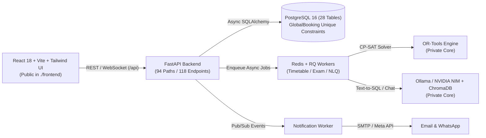

<div align="center">

# 📅 ScheduleX

### AI-Powered Smart Timetable, Exam & Academic Resource Optimization Platform

[](./frontend)
[](./docs/API_OVERVIEW.md)
[](./docs/ARCHITECTURE.md)
[](./docs/ARCHITECTURE.md)
[](./LICENSE)

*Privacy-first, multi-tenant academic scheduling platform built for universities and engineering colleges.*  
*Zero clashes guaranteed at both solver and database levels — powered by Google OR-Tools CP-SAT, local/NIM LLMs, ChromaDB semantic ranking, and automated multi-channel alerts.*

> **Repository Scope Notice:** This public showcase repository provides the complete **React + TypeScript frontend** (`./frontend`), **OpenAPI 3.1 contract & endpoint directory** (`./docs/API_OVERVIEW.md` & `./docs/openapi.json`), **system architecture documentation** (`./docs/ARCHITECTURE.md`), and **11-sheet smart Excel datasets** (`import_template.xlsx`, `import_template_gcet.xlsx`).  
> The proprietary backend scheduling engine, AI/LLM pipelines, differential ingestion logic, and background workers live in a private repository (`ScheduleX_Pvt`) to protect intellectual property. Live technical walkthroughs are available on request.

</div>

---

## 🎯 Problem Solved

University timetabling breaks down quickly when done manually or with greedy scripts because real campuses have tightly coupled constraints:
- **Shared Cross-Program Resources**: The same department professors and labs serve multiple branches (e.g., `CP`, `CSD`, `IT`) and semesters simultaneously — scheduling one branch independently causes double-booking.
- **Labs, Electives & Parallel Sync**: Practical labs require multi-batch splitting and contiguous periods; open/program electives (`ParallelGroup`) must run concurrently across student groups.
- **Exam Clashes & Seating Logistics**: Midterm/final exams must skip institutional holidays, prevent backlog student overlaps, and compute roll-number seating layouts without exhausting invigilators.
- **Day-to-Day Disruptions**: Faculty absences require rapid, qualified substitutions — ranked fairly and auto-escalated if unanswered.

**ScheduleX** unifies these workflows into a single platform backed by exact constraint programming (OR-Tools CP-SAT), database uniqueness locks (`GlobalBooking`), background Redis/RQ queues, and conversational/SQL AI tools.

---

## ✨ Key Capabilities & Modules

| Module | What It Delivers |
| :--- | :--- |
| 🧠 **CP-SAT Timetable Engine** | Solves theory + multi-batch lab assignments via Google OR-Tools with hard clash-free constraints and weighted soft objectives, home-classroom anchoring (`fixed_home_rooms` / `auto_allot_home_rooms`), elective boundary placement, `ParallelGroup` sync, and a `0–100` optimization score. |
| 🏛️ **Multi-Branch & Multi-Semester** | Scopes subjects and batches by `(dept_id, program_id, semester)` while sharing departmental faculty (`dept_id`) and college-wide rooms cleanly across branches without conflicts. |
| 🎓 **Exam Scheduler & Seating** | Generates date sheets across semesters while skipping `AcademicHoliday` dates, prevents backlog student clashes from enrolment sheets, computes **Continuous** or **Mixed** (interleaved) room seating with roll-number ranges, and balances invigilator duties. |
| 🛡️ **Invigilator Duty Workflow** | Dedicated faculty workflow (`/exams/my-duties`) to **Confirm** or **Decline** upcoming invigilation duties — declining automatically triggers clash-free faculty reassignment. |
| 🖱️ **Interactive Editor & Cloning** | Admins can switch into **Edit / Swap Slots** mode on the timetable grid to swap lectures with live `GlobalBooking` clash checks, or **Clone** an existing timetable into a new academic year. |
| 🔄 **Substitution & Auto-Escalation** | Ranks replacement faculty using ChromaDB expertise embeddings, workload headroom, and recency; sends interactive WhatsApp/Email offers and auto-escalates after timeout via RQ workers. |
| 💬 **AI Assistant & Text-to-SQL** | Natural-language chatbot (`/chat/message`) plus an **AI Query (SQL)** dashboard (`/analytics/nlq`) translating plain English into validated read-only `SELECT` SQL with sortable tables, Recharts bar visualizations, and CSV export. |
| 📥 **11-Sheet Differential Excel Import** | Downloadable [`import_template.xlsx`](./import_template.xlsx). Subsequent uploads execute a **column-level delta upsert**, updating *only* modified fields while preserving unchanged rows, IDs, passwords, and logs. |
| 📤 **Multi-Format Exports** | Department, Faculty-wise, Room-wise, Exam Date Sheet/Seating, and **NAAC Compliance Report** PDFs, styled multi-sheet **Excel Workbooks**, and **RFC 5545 `.ics` Calendar Feeds**. |
| ⚙️ **Institution Settings & Holidays** | Persists college-wide scheduling rules (academic year, Saturday working toggle, max daily hours, slot duration) and institutional holidays respected by all engines. |

---

## 🏗️ System Architecture



- Deep technical breakdown: [`docs/ARCHITECTURE.md`](./docs/ARCHITECTURE.md)
- Complete API endpoint directory (human-readable tables): [`docs/API_OVERVIEW.md`](./docs/API_OVERVIEW.md)
- Machine-readable FastAPI spec: [`docs/openapi.json`](./docs/openapi.json) (`94` paths · `118` HTTP operations · `81` schemas)

---

## 🖥️ Frontend Application & Role-Based Views

Browse the full React 18 + TypeScript implementation inside [`./frontend/src`](./frontend/src):

| Role / Area | Key Routes & Source Files |
| :--- | :--- |
| **Admin (`super_admin`)** | [Dashboard](./frontend/src/pages/Dashboard.tsx) · [User Management](./frontend/src/pages/admin/UserManagement.tsx) · [Excel/PDF Import](./frontend/src/pages/admin/PdfImport.tsx) · [Institution Settings](./frontend/src/pages/Settings.tsx) |
| **HOD (`dept_admin`)** | [HOD Dashboard](./frontend/src/pages/dashboards/HodDashboard.tsx) · [Time Slots](./frontend/src/pages/setup/TimeSlots.tsx) · [Subjects](./frontend/src/pages/setup/Subjects.tsx) · [Faculty](./frontend/src/pages/setup/Faculty.tsx) · [Rooms](./frontend/src/pages/setup/Rooms.tsx) |
| **Timetabling & AI** | [Generate Timetable](./frontend/src/pages/timetable/Generate.tsx) · [Timetable List](./frontend/src/pages/timetable/List.tsx) · [Weekly Grid & Swap Editor](./frontend/src/pages/timetable/View.tsx) · [Conflicts](./frontend/src/pages/timetable/Conflicts.tsx) · [AI Query (NLQ)](./frontend/src/pages/NlqAnalytics.tsx) |
| **Exams & Substitutions** | [Create Exam](./frontend/src/pages/exam/CreateExam.tsx) · [Exam List](./frontend/src/pages/exam/ExamList.tsx) · [Exam View & Seating](./frontend/src/pages/exam/ExamView.tsx) · [Scheduling & Substitutions](./frontend/src/pages/Scheduling.tsx) |
| **Faculty (`faculty`) & Exports** | [Faculty Dashboard & Exam Duties](./frontend/src/pages/dashboards/FacultyDashboard.tsx) · [Multi-Format Export Center](./frontend/src/pages/Export.tsx) · [AI Chat Panel](./frontend/src/components/layout/ChatPanel.tsx) |

---

## 📊 Smart 11-Sheet Excel Import Schema

Inspect [`import_template.xlsx`](./import_template.xlsx) and [`import_template_gcet.xlsx`](./import_template_gcet.xlsx) to see how multi-branch academic data, shared faculty pools, electives, holidays, and exam backlog enrolments are structured:

| Sheet | Columns | Natural Key (Delta Upsert) |
| :--- | :--- | :--- |
| **Departments** | `Code, Name` | `(college_id, Code)` |
| **Programs** | `Department, Code, Name, Level, DurationYears, Intake` | `(dept_id, Code)` |
| **Faculty** | `Department, Name, EmployeeID, Email, Phone, Expertise, MaxLoad, PreferredTime, Role` | `(college_id, Email)` |
| **Subjects** | `Department, Program, Name, Code, Semester, Credits, LectureHours, TutorialHours, LabHours, StudentCount, ElectiveGroup, ParallelGroup` | `(program_id, Code, Semester)` |
| **Rooms** | `Name, Capacity, Type, Projector, Computers, AC` | `(college_id, Name)` |
| **Venues** | `Name, Capacity, Type` | `(college_id, Name)` |
| **Time Slots** | `Order, Label, StartTime, EndTime, Type` | `(college_id, Order)` |
| **Batches** | `Department, Program, Semester, Name, Size` | `(program_id, Semester, Name)` |
| **Global Events** | `Name, Day, SlotOrder` | `(college_id, Day, SlotOrder)` |
| **Holidays** | `Name, Date, Type` | `(college_id, Date, Name)` |
| **Exam Enrolments** | `StudentID, SubjectCode, Semester, IsBacklog` | `(college_id, StudentID, Subject)` |

---

## 🛠️ Tech Stack

| Layer | Technologies |
| :--- | :--- |
| **Frontend (Public)** | React 18, TypeScript, Vite, Tailwind CSS, shadcn/ui (Radix), TanStack React Query, Zustand, Recharts, Vitest |
| **Backend API (Private)** | Python, FastAPI, Pydantic v2, Async SQLAlchemy, Alembic, JWT + RBAC, WeasyPrint, OpenPyXL |
| **Optimization Engine (Private)** | Google OR-Tools CP-SAT Solver, Custom Hard/Soft Constraints, Infeasibility Explainer |
| **Async & AI (Private)** | PostgreSQL 16, Redis + RQ Workers, Ollama / NVIDIA NIM LLMs, ChromaDB Embeddings, SMTP + Meta WhatsApp API |

---

## 💻 Build & Test the Frontend Locally

```bash
cd frontend
npm install
npx tsc -p tsconfig.app.json --noEmit
npm run build
npm test -- --run
```

To run the Vite development UI against a compatible backend server conforming to [`docs/openapi.json`](./docs/openapi.json):
```bash
npm run dev   # Serves on http://localhost:8080 and proxies /api -> http://localhost:8000
```

---

## 📜 Copyright & License

© 2026 **Dhiraj Rajai (DMR DEVELOPERS)**. All Rights Reserved.  
Published for **portfolio evaluation, technical architecture inspection, and recruitment review** — see [`LICENSE`](./LICENSE) and [`SECURITY.md`](./SECURITY.md).
