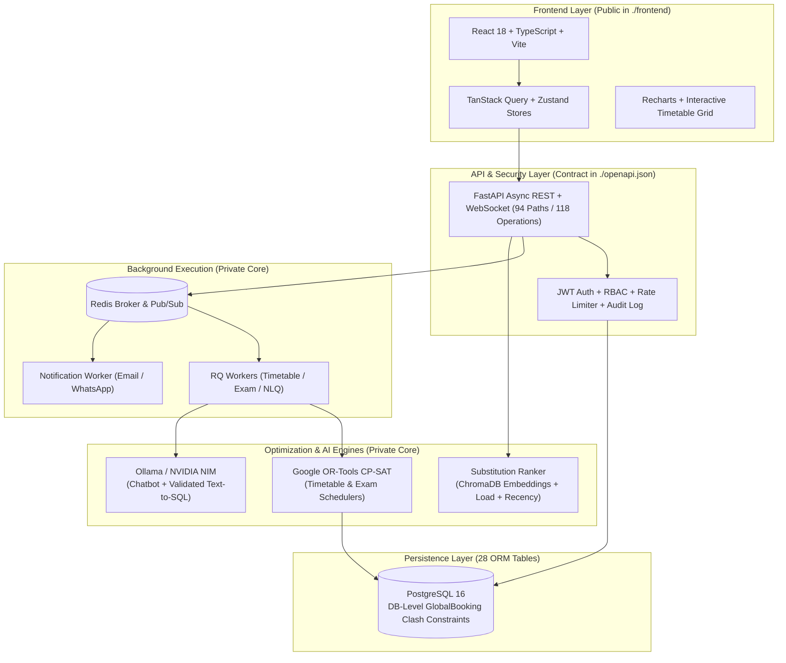

# ScheduleX — System Architecture & Design Overview

> Copyright (c) 2026 Dhiraj Rajai (DMR DEVELOPERS). All Rights Reserved.

---

## 1. End-to-End Platform Architecture

---

## 2. Core Engineering Guarantees

### Zero Clashes at Both Solver and Database Layers
- Every scheduled lecture, lab, and slot swap writes into `global_bookings`.
- Database-level unique constraints guarantee that within a single `college_id`:
  - A **faculty member** cannot be double-booked across any department or program at the same `(day, period)`.
  - A **classroom/lab** cannot be double-booked across any department or program at the same `(day, period)`.
- Interactive manual slot swaps validate target slots against `global_bookings` atomically before committing.

### Multi-Branch, Multi-Semester & Elective Isolation
- **Departments own Faculty; Programs own Subjects & Batches**:
  - A professor belongs to the department (`dept_id`) and can teach across multiple programs (`CP`, `CSD`, `IT`) and semesters.
  - Subjects are keyed by `(program_id, code, semester)`, allowing the same elective code (e.g., *Cloud Computing*) to exist independently in Semester 5 for one branch and Semester 6 for another.
- **Parallel Groups & Elective Sync**:
  - Sharing a `parallel_group` synchronizes elective options to run at identical time slots.
  - Sharing an `elective_group` aligns exam dates when appropriate while preventing backlog student overlaps.

### Exam Scheduling, Seating & Invigilation Pipeline
1. **Date-Sheet Generation**: Avoids non-working days (respecting college Saturday settings) and excludes entries in `AcademicHoliday`. Enforces zero student exam clashes including backlog (`is_backlog=true`) enrolments loaded from Excel.
2. **Seating Allocation**: Computes room assignments using either **Continuous** (grouped per subject) or **Mixed** (interleaved branches/subjects) policies with explicit roll-number ranges.
3. **Invigilator Assignment & Duty Confirmation**: Balances duty counts across faculty, avoids double-booking, and exposes `/exams/my-duties` where faculty can **Confirm** or **Decline** (triggering automatic clash-free reassignment).

### Smart Differential Excel Ingestion (11 Sheets)
- Supports 11 interdependent sheets (`Departments`, `Programs`, `Faculty`, `Subjects`, `Rooms`, `Venues`, `Time Slots`, `Batches`, `Global Events`, `Holidays`, `Exam Enrolments`).
- Every re-upload performs a **column-level delta upsert** keyed by domain natural keys, returning `inserted`, `updated`, and `unchanged` counts while preserving unmodified rows, user credentials, and substitution logs.

---

## 3. Role-Based Access Control (RBAC)

Matches route guards defined in [`../frontend/src/App.tsx`](../frontend/src/App.tsx) and [`../frontend/src/components/layout/RoleDashboard.tsx`](../frontend/src/components/layout/RoleDashboard.tsx):

| Role | Scope & Capabilities |
| :--- | :--- |
| `super_admin` | Multi-tenant institution setup, user administration, 11-sheet Excel import, global events, holidays, timetable generation & slot swap, exam scheduling, NAAC reports, NLQ analytics |
| `dept_admin` (HOD) | Department/program oversight, time slots, subjects, faculty & rooms setup, timetable generation/conflict inspection, exam creation & seating, substitutions, NLQ analytics |
| `faculty` | Personal weekly timetable dashboard, `.ics` calendar export, substitution schedule & responses, invigilator duty confirmation/decline |

---

## 4. API Documentation

- Clean endpoint reference tables grouped by domain: [`./API_OVERVIEW.md`](./API_OVERVIEW.md)
- Complete FastAPI OpenAPI 3.1 JSON schema (`94` paths, `118` HTTP operations, `81` schemas): [`./openapi.json`](./openapi.json)
